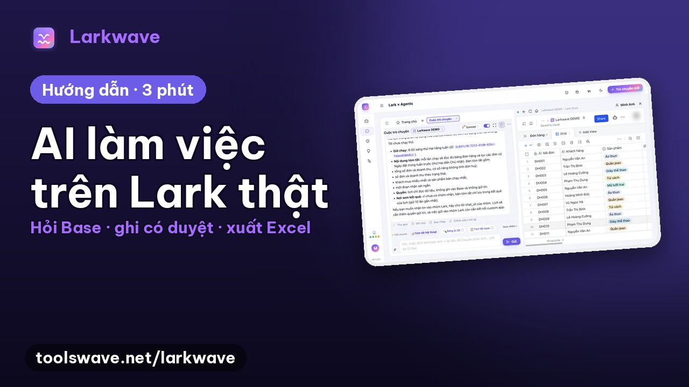
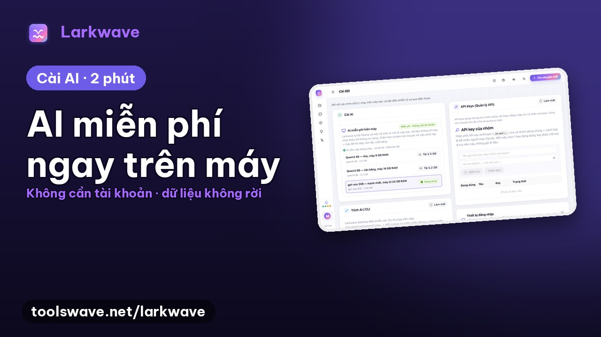

# Larkwave

**AI agent làm việc thật trong Lark.** Màn Lark × Agents cho bạn chat với một agent đang cầm phiên
Lark web của chính bạn. Agent đọc và ghi Base, Sheet, Doc, Drive; tạo automation/workflow (để TẮT cho
bạn tự bật); xuất tệp xlsx/docx/pdf; và chạy lịch tự động. Mỗi tab là một hội thoại kèm một trang Lark
riêng, và app hỗ trợ nhiều tài khoản Lark. Đi kèm có Trợ lý AI, Kỹ năng (kể cả Zalo/Gmail qua kỹ
năng), điều khiển từ xa.

## 🎬 Video hướng dẫn sử dụng

https://github.com/user-attachments/assets/e639c159-65c0-4dac-a684-e5b0c1970d53


Bản ngắn 1:40: hỏi đáp dữ liệu Base, ghi bản ghi có xin phép, xuất Excel. Bản đầy đủ 3:20 có các chương: Tổng
quan → kết nối Lark bằng QR → hỏi đáp Base → ghi có xin phép → xuất Excel → lịch tự động → Kỹ năng → trình AI trên
máy. Tài khoản và dữ liệu trong video là dữ liệu mẫu.

[](https://github.com/vungochaianh/larkwave/releases/download/video-hdsd/HDSD-Larkwave.mp4)

▶ [Bản đầy đủ 3:20 (MP4, 28 MB)](https://github.com/vungochaianh/larkwave/releases/download/video-hdsd/HDSD-Larkwave.mp4) · [Bản ngắn 1:40 (MP4, 9 MB)](https://github.com/vungochaianh/larkwave/releases/download/video-hdsd/HDSD-Larkwave-ngan.mp4) · [Phụ đề .srt](https://github.com/vungochaianh/larkwave/releases/download/video-hdsd/HDSD-Larkwave.srt)

### Cài AI miễn phí ngay trong app (0.1.24)

https://github.com/user-attachments/assets/d86e7049-8c9b-4bdc-9776-2a6a5c9a80d1


Không cần cài Claude hay mở terminal: **Cài đặt → Cài AI** để Larkwave tự tải Ollama và một mô hình mở chạy ngay
trên máy (miễn phí, không cần tài khoản, dữ liệu không rời máy), hoặc cài Claude một bấm bằng trình cài chính thức
của Anthropic.

[](https://github.com/vungochaianh/larkwave/releases/download/video-hdsd/HDSD-Larkwave-Cai-AI.mp4)

▶ [Video Cài AI 1:40 (MP4, 14 MB)](https://github.com/vungochaianh/larkwave/releases/download/video-hdsd/HDSD-Larkwave-Cai-AI.mp4) · [Bản 720p (9 MB)](https://github.com/vungochaianh/larkwave/releases/download/video-hdsd/HDSD-Larkwave-Cai-AI-ngan.mp4) · [Phụ đề .srt](https://github.com/vungochaianh/larkwave/releases/download/video-hdsd/HDSD-Larkwave-Cai-AI.srt)

## Tải và cài

| | Link |
|---|---|
| Trang tải (luôn là bản mới nhất) | <https://toolswave.net/larkwave> |
| macOS 0.1.25 (universal, tải thẳng) | <https://gitlab.com/api/v4/projects/83700259/packages/generic/larkwave-desktop/0.1.25/Larkwave-0.1.25-universal.dmg> |
| Windows | **chưa có**: máy Windows đang được bàn giao, xem [docs/may-phat-hanh-windows.md](docs/may-phat-hanh-windows.md) |
| Manifest phát hành (app và trang tải cùng đọc) | <https://toolswave.net/api/apps-release/larkwave> |
| Mọi bản cũ (registry) | <https://gitlab.com/deveris.vu/toolswave-desktop-release/-/packages> |

- **Cài lần đầu trên macOS:** bản cài ký ad-hoc, chưa notarize. Lần mở đầu macOS sẽ chặn: vào
  **Cài đặt hệ thống → Quyền riêng tư & Bảo mật → Vẫn mở**.
- **Tài khoản:** dùng chung tài khoản Toolswave. App gọi `https://api.toolswave.net/v1`. Dữ liệu Lark
  của app Toolswave cũ được nhập tự động.
- **Cập nhật:** giao diện tự cập nhật (code-push) khi mở app. Đổi lõi thì app nhắc tải bản cài mới.

## Dùng không cần tài khoản: dữ liệu chỉ trên máy (từ 0.1.25)

Ở màn đăng nhập, bấm **"Dùng ngay — không cần tài khoản"**. Từ lúc đó app **không gọi máy chủ
Larkwave/Toolswave**: không token, không sao lưu/đồng bộ hội thoại, không điều khiển từ xa, không
code-push. App giữ chế độ này cả sau khi khởi động lại. Muốn dùng tài khoản thì mở menu tài khoản ở góc
dưới bên trái → **Đăng nhập tài khoản Larkwave**.

- **AI:** dùng AI miễn phí trên máy (thẻ **Cài AI**: Ollama + mô hình mở) hoặc Claude/Gemini/Grok/Codex
  CLI của chính bạn. Gói Larkwave (AI máy chủ) cần tài khoản.
- **Lark:** agent dùng phiên Lark web bạn đăng nhập ngay trong app. Cookie và App Secret không rời máy.
- **Dữ liệu nằm ở đâu:** thư mục dữ liệu của app, gồm hội thoại, kỹ năng, lịch, tệp xuất, phiên Lark
  và mô hình AI:
  - macOS: `~/Library/Application Support/Larkwave/`
  - Windows: `%APPDATA%\Larkwave\`
  - Cờ chế độ nằm ở `local-mode.json`, dữ liệu Lark ở khoang `lark/accounts/_local/`.
- **Bản tự dựng từ mã nguồn:** đặt `LARKWAVE_LOCAL_ONLY=1` để **ép** chế độ này (giao diện không tắt
  được), ví dụ `LARKWAVE_LOCAL_ONLY=1 /Applications/Larkwave.app/Contents/MacOS/Larkwave`.
- **Cần tài khoản:** điều khiển từ xa qua điện thoại, chia sẻ cuộc trò chuyện, sao lưu đám mây, Gói
  Larkwave và nhập dữ liệu từ app Toolswave cũ.

## Tự dựng từ mã nguồn (macOS)

Cần macOS, git, Node.js 20 trở lên (đã thử với Node 25) và pnpm 9 (`corepack enable` hoặc
`npm i -g pnpm@9`).

```bash
git clone https://github.com/vungochaianh/larkwave.git
cd larkwave
pnpm install
pnpm --filter @larkwave/shared build && pnpm --filter @larkwave/core build
cd apps/desktop
CSC_IDENTITY_AUTO_DISCOVERY=false pnpm dist:mac
```

- Bản cài ra ở `apps/desktop/dist/Larkwave-<phiên bản>-universal.dmg`. Đã thử trên một bản clone sạch
  ngày 23/11/2026: `pnpm install` khoảng 1 phút, `dist:mac` khoảng 2 phút.
- Dựng shared + core **trước** desktop. Bỏ bước này thì app trắng màn hình mà lúc dựng không báo lỗi.
- Chạy thử không cần dựng bản cài: `pnpm dev` trong `apps/desktop`.

Larkwave tách từ Toolswave ngày 06/10/2026 và **không có** phần dựng app (phần đó ở Appwave). Chi
tiết: [docs/TACH-APP.md](docs/TACH-APP.md).

> **Làm việc với Claude Code:** mở session ngay trong thư mục này. Claude tự đọc
> [CLAUDE.md](CLAUDE.md), nơi ghi kiến trúc thật, lệnh, quy trình phát hành, **luật kiểm thử với Lark
> thật**, luật an toàn và các bẫy đã gặp. Mở lại phiên thì đọc
> [docs/ban-giao-phien.md](docs/ban-giao-phien.md) trước.

## Mã nguồn

- Mã nguồn mở, giấy phép [MIT](LICENSE): <https://github.com/vungochaianh/larkwave>.
- Bản làm việc chính (máy Mac ↔ Windows bàn giao qua đây): `https://gitlab.com/toolswave/larkwave` (riêng tư).
- Máy chủ (API + trang web) **không** nằm ở đây mà ở repo Toolswave `gitlab.com/toolswave/app`.

## Thành phần

```text
apps/
  desktop/    Nextron (Electron) — Lark × Agents, tự động hoá, kỹ năng, kết nối Zalo/Gmail, CMS Bitable
              sync, plugin; chạy trên CLI AI của máy (Claude/Codex/Gemini/Grok) hoặc API trực tiếp
packages/
  shared/     Kiểu dữ liệu dùng chung với API Toolswave
  core/       Hợp đồng RuntimeAdapter + kênh IPC + logic thuần
  ui/         Giao diện (LarkScreen, LarkChatShell, ZaloSyncPanel…)
scripts/      Phát hành (push-installers, push-renderer, win-release.ps1), kiểm thử khói, bàn giao
tw-lark-runner/  Bộ chạy lịch Lark 24/7 trên VM — CHƯA deploy từ repo này
tw-cms-keeper/   Giữ phiên Lark web cho CMS sync — CHƯA deploy từ repo này
tw-agent-host/   Phục vụ lượt Trợ lý AI được chia sẻ — CHƯA deploy từ repo này
cms-lark-sync/   Dịch vụ đồng bộ CMS ⇄ Bitable (độc lập, ngoài workspace)
deploy/          Script máy chủ thời Toolswave — KHÔNG dùng; máy chủ deploy từ toolswave/app
```

`apps/api` và `apps/web` (bản sao máy chủ Toolswave) đã gỡ khỏi repo ngày 19/10/2026.

## Kiểm tra nhanh

```bash
pnpm install
pnpm --filter @larkwave/shared build && pnpm --filter @larkwave/core build   # LUÔN trước desktop
pnpm --filter @larkwave/ui typecheck
pnpm --filter @larkwave/desktop typecheck:desktop
bash apps/desktop/test/run.sh
node scripts/check-duplicates.mjs
node scripts/check-toolswave-api.mjs      # mọi đường app gọi phải có trên API Toolswave
node scripts/handoff.mjs                  # đầu phiên: git / phiên bản / bản đang phát hành
```

## Phát hành

- **macOS** (chỉ máy Mac): bản cài lên GitLab registry (gói `larkwave-desktop`, project 83700259).
  Giao diện code-push qua Cloudflare Pages (`larkwave-desktop-renderer`). Từng bước ở
  [CLAUDE.md](CLAUDE.md) § Phát hành và [docs/code-push.md](docs/code-push.md).
- **Windows** (chỉ máy Windows): `scripts\win-release.ps1`, xem
  [docs/may-phat-hanh-windows.md](docs/may-phat-hanh-windows.md).
- Mọi script phát hành bị chặn bằng `ALLOW_DEPLOY=1`. Khoá không nằm trong repo.
