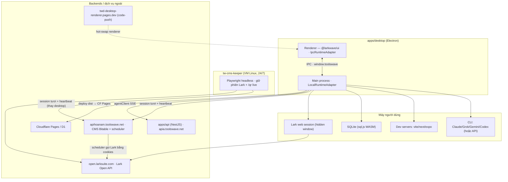

# Toolswave — Đặc tả hệ thống (Developer Reference)

> Phiên bản desktop hiện tại: **v1.0.208** (`packages/ui/src/changelog.ts` → `APP_VERSION = CHANGELOG[0].version`). Cập nhật: 2026-08-15.
> Quy ước: văn xuôi tiếng Việt, đường dẫn/định danh giữ nguyên tiếng Anh. Mọi đường dẫn tính từ gốc monorepo.
>
> **Cách góp ý lỗi:** khi báo bug, trỏ tới **đường dẫn file/thư mục** ở §3. §6 là các cạm bẫy đã biết, §7 là roadmap.

---

## 1. Tổng quan hệ thống

**Toolswave** là nền tảng "gõ một câu lệnh, ra app ngay". Trái tim là **ứng dụng desktop (Electron)** đóng vai builder AI: nó điều khiển **CLI chạy cục bộ trên máy người dùng** (Claude / Grok / Gemini / Codex — hoặc gọi API trực tiếp) để sinh code, chạy dev server, xem preview, duyệt SQLite cục bộ, rồi deploy. Kèm theo desktop là các mảng phụ trợ: **web companion** (`apps/web`, Next.js — builder chạy server-side, tính phí theo token), **API** (`apps/api`, NestJS — account, codegen web, relay điều-khiển-từ-xa, admin, billing), **Lark × Agents** (agent đọc/ghi workspace Lark qua bộ tool có kiểm soát), **đồng bộ CMS Bitable** (giữ phiên Lark web sống để nuôi các job sync ở backend `apihoanam`), và **VM keeper** (`tw-cms-keeper` — dịch vụ headless chạy trên VM Linux giữ phiên Lark 24/7, thay cho việc phải mở desktop).

Toàn hệ gồm **3 app** (`apps/desktop`, `apps/web`, `apps/api`), **3 package dùng chung** (`packages/ui` — thư viện React đa nền tảng; `packages/core` — hợp đồng `RuntimeAdapter`; `packages/shared` — kiểu wire liên tầng), **1 dịch vụ VM độc lập** (`tw-cms-keeper`) và các backend/dịch vụ ngoài: `apia.toolswave.net` (apps/api), `apihoanam.toolswave.net` (CMS Bitable), `app.toolswave.net` (nền tảng + đích OAuth callback), `open.larksuite.com` (Lark Open API), `twd-desktop-renderer.pages.dev` (code-push renderer), **Cloudflare Pages/D1** (đích deploy), **SePay** (thanh toán). Mấu chốt kiến trúc: mọi component UI chỉ nói chuyện với thế giới bên ngoài qua **một `RuntimeAdapter` được tiêm vào** — desktop tiêm `IpcRuntimeAdapter` (IPC → main), web tiêm `WebRuntimeAdapter` (REST/SSE).

---

## 2. Kiến trúc

Các "dây" nối các mảnh: **(1)** desktop main ↔ renderer qua **IPC**; **(2)** web ↔ api qua **REST + SSE**; **(3)** phone/web → api → desktop qua **RELAY** (SSE); **(4)** desktop → **apihoanam** cho CMS Bitable; **(5)** **VM keeper → apihoanam** (đẩy session tươi + heartbeat) — thay desktop giữ phiên 24/7. Hai đường cập nhật desktop tách biệt: **renderer code-push** (hot-swap từ pages.dev) và **installer `.dmg`/`.zip`** (đóng gói lại LÕI/preload) — nhiều bug "tính năng im lặng biến mất" là do renderer mới chạy trên preload/core cũ.



---

## 3. Cây thư mục chi tiết

> Mục quan trọng nhất — định vị bug theo thư mục.

### 3.1 `apps/desktop/main` — main process (build/preview/deploy engine)

Chạy trong main (Node) process; sở hữu filesystem/child-process. Renderer chỉ gọi qua `ipcMain.handle` khai báo trong `background.ts`. `LocalRuntimeAdapter` là hub duy nhất hiện thực `RuntimeAdapter`.

```
apps/desktop/main/
├── background.ts          IPC registry + vòng đời BrowserWindow (~200 kênh handle). Khởi tạo LocalRuntimeAdapter,
│                          AccountCache, AccountTokenStore, AgentClient. Stream build qua streamId. Kèm deep-link OAuth,
│                          single-instance lock, CORS proxy account-API, code-push hot-swap, restoreMainWindow.
├── preload.ts             contextBridge phơi kênh IPC ra renderer (CH object riêng, không import từ core).
├── codePush.ts            OTA resolver: nạp renderer pages.dev nếu tương thích, không thì bản bundle.
├── accountCache.ts / accountTokenStore.ts   cache account offline-first / mirror JWT độc lập origin.
├── authWindow.ts / authLoopback.ts          OAuth trong app (chặn callback URL) / fallback loopback.
└── runtime/
    ├── localAdapter.ts    ★ HUB. createBuild (pipeline codegen), smokeBuild, renderCheck, listApps, deploy (CF Pages),
    │                       deployServer (Docker), importLocalFolder, apps-index + resolveAppDir, appFiles/DB/api…
    ├── promptCompose.ts   BUILD_SYSTEM_PROMPT + HELP_SYSTEM_PROMPT + resolveSystemPrompt.
    ├── renderGuard.ts     Chống màn trắng: entryChainMissing, appLooksStub, ensureRenderableEntry.
    ├── claudeRunner.ts / apiBuilder.ts / apiRunner.ts   spawn CLI / engine API-trực-tiếp / vòng tool-use đa provider.
    ├── preview.ts / detectApp.ts   dev-server per-service + detect framework/dep.
    ├── agentClient.ts / agentLock.ts   relay SSE phone→desktop / khóa "một lượt AI".
    ├── appDb.ts / contextBudget.ts / codegraph.ts / siteCapture.ts / appShot.ts
    ├── runners/ · skills/ · plugins/   registry đa CLI · SKILL.md per-model · plugin Lark data-only.
    └── lark/               Xem 3.2.
```

### 3.2 `apps/desktop/main/runtime/lark` — Lark × Agents + CMS Bitable

```
lark/
├── larkService.ts       FACADE. Session chat per-account, bot, OAuth, registry Base, timers, wiring CMS.
│                         Timers: cmsRefreshTimer 30' (refreshAll) + heal 20s sau boot; healthTimer 10'.
├── larkAgent.ts / larkApiAgent.ts / larkOrchestrator.ts   một lượt chat (CLI / API / tự-parse tool cho Grok…).
├── mcpServer.ts / systemPrompt.ts / larkClient.ts / larkOAuth.ts / secretStore.ts
├── larkWebSession.ts    Hidden Lark WEB window per-account. Sniff /space/api/ lấy csrf/docs-host-id; getConnectorSession.
├── cmsSyncService.ts    Client backend apihoanam: list/create job + PUSH session tươi; refreshAll (refresh+revive);
│                         getErrorReport/setErrorReport; getKeeperStatus (đọc heartbeat VM). execute (Approach-B).
├── specBuilder.ts / automationEngine.ts / tunnel.ts / webhook.ts
└── tools/               Registry tool Lark (gated=ghi): bitable (21 tool), workflows, larkUi, cmsSync, messaging, docs…
```

### 3.3 `apps/desktop/renderer` + `packages/ui/src` — Renderer + UI dùng chung

`packages/ui` dùng bởi **cả** desktop renderer **và** `apps/web`; component nói với ngoài chỉ qua `RuntimeAdapter` được tiêm. Cơ chế quan trọng khi tìm bug "có trên desktop, thiếu trên web": component feature-gate theo sự tồn tại của method (`runtime.claude`, `runtime.larkChat`, `runtime.cmsSyncKeeperStatus`…).

```
apps/desktop/renderer/
├── pages/_app.tsx        Khởi tạo MỘT IpcRuntimeAdapter; bọc RuntimeProvider + ErrorBoundary; window.toolswave? → BrowserNotice.
├── pages/home.tsx        Render HomeScreen.
└── runtime/ipcAdapter.ts Adapter desktop (~870 dòng). Mỗi method = một bridge call; nhiều guard `if(!bridge.X) return fallback`
                          vì renderer code-push có thể chạy trên preload CŨ.

packages/ui/src/
├── RuntimeProvider.tsx / ThemeProvider.tsx / theme.ts / index.ts (barrel apps/web import)
├── adapters/webAdapter.ts   WebRuntimeAdapter (server-backed).
├── changelog.ts             CHANGELOG[] (APP_VERSION = [0].version = 1.0.208).
├── components/
│   ├── HomeScreen · AppShell · Composer · AppWorkspace · WorkspacePanes · PreviewPane · BuildProgress · WorkspaceTabStrip
│   ├── CodeView · DatabaseView · ApiTesterPane · PromptInspector · AppsGrid · SkillsScreen · SettingsScreen · LarkScreen
│   ├── lark/  LarkChat · CmsSyncScreen (★ có thẻ "Máy VM giữ phiên") · SpecScreen · BasesPanel · BotPanel · PluginsPanel …
│   └── account/  auth · api (→apia) · Explore/Profile/Leaderboard/Reports · admin/ (18 file) · CheckoutModal
```

### 3.4 `apps/web` — Web companion (Next.js đã fork)

```
apps/web/src/
├── proxy.ts           Middleware edge auth-gate. PUBLIC_PATHS allowlist. GOTCHA: route public MỚI phải thêm vào đây.
├── app/ (builder)/    Nhóm ĐÃ ĐĂNG NHẬP: builder home, apps/[id], remote/agent, remote/lark, billing/pricing/templates…
├── app/admin/         Console admin (16 trang): users, billing, payments, feedback, builds, deployments, ai, blog…
├── app/ (public)     app/[slug] · blog · explore · u/[handle] · download · lark/s/[id] · studio/login/register
├── components/ (~52)  AppShell/AdminShell/AuthGuard · PromptComposer/BuildThread · PreviewPane/CodeBrowser/DbBrowser · LarkRelogin
└── lib/api.ts (49KB)  Client API + SSE: streamBuild, streamMessages, streamRemoteTasks, streamLarkQr, streamCmsSync…
```

### 3.5 `apps/api` — Backend (NestJS, prefix v1)

```
apps/api/src/
├── agent/    RELAY phone→desktop (SSE), tasks, devices, telegram, lark-login, cms-sync/{jobs,run,result}, webhook.
├── engine/   Codegen SERVER-SIDE (web builder), blueprint, cloudflare-pages, git-providers, site-clone, scaffold.
├── pipeline/ · builds/ · deployments/ · server-deploy/ · apps/ (CRUD, members, seo, secrets, D1)
├── auth/ · users/ · me/ · billing/ (%-token) · payments/ (SePay) · ai-keys/ · assistant/ · automations/
├── suggestions/ · feedback/ · reports/ · audit/ · blog/ · templates/ · leaderboard/ · social/ · notifications/
├── public/ (share) · lark-backup/ · lark-grant/ · lark-share/ · events/ (pub/sub in-process) · common/ (crypto, authz)
```

### 3.6 `packages/core` — Hợp đồng `RuntimeAdapter`

```
packages/core/src/runtime.ts   interface RuntimeAdapter (biên DUY NHẤT renderer gọi; đa số method optional).
                               Types: BuildEvent, AppSummary, CmsSyncJob, CmsSyncErrorReport, CmsKeeperStatus…
packages/core/src/index.ts     CHANNELS (tw:*) — mỗi IPC method một hằng.
```

### 3.7 `packages/shared` — Kiểu wire liên tầng

```
packages/shared/src/index.ts   AgentCommand (task|cancel|ping|larkLogin|cmsSyncRun), RemoteTask, CmsSyncStreamEvent,
                               LarkQrStreamEvent, RUNNER_CATALOG, TESTER_RANKS…
```

### 3.8 `tw-cms-keeper` — Dịch vụ VM giữ phiên 24/7 (MỚI, 1.0.208)

Node + Playwright (Chromium headless) độc lập, chạy trên VM Linux. Gánh đúng phần desktop giữ: phiên Lark web sống + đẩy session tươi cho các job CMS mỗi 30 phút → sync chạy khi desktop/Mac tắt. Deploy hiện tại: box `100.100.164.92` (`/opt/tw-cms-keeper`, systemd `tw-cms-keeper.service`, `User=root`, `HOME=/root`, headless).

```
tw-cms-keeper/
├── src/config.js       env (CMS_API_BASE, LARK_HOST, REFRESH/KEEPALIVE_INTERVAL, KEEPER_HTTP_PORT/PUBLIC_URL, ALERT_WEBHOOK).
├── src/cms.js          client apihoanam: listJobs, refreshAll (+isSessionExpiryDisabled revive), fetchStoredSession, postHeartbeat.
├── src/session.js      Playwright: launch (headed/headless), keepAlive, isLoggedIn, getConnectorSession, openQrLogin,
│                        refreshQrIfStale, seedCookies, screenshotTo. Headed cần openbox + --disable-gpu + --window-size.
├── src/httpServer.js   /status (JSON) + /qr (trang QR SỐNG tự làm mới) + /qr.png.
├── src/keeper.js       Vòng tick: khỏe → keepAlive+refresh (30'); mất session → QR mode + báo cảnh báo kèm reloginUrl; heartbeat mỗi tick.
├── src/index.js        CLI: login-qr / seed-from-backend / seed-cookies / run / once / jobs.
├── systemd/tw-cms-keeper.service · scripts/install-ubuntu.sh · README.md
```

---

## 4. Bản đồ tính năng

| Tính năng | Desktop (`apps/desktop`+`packages/ui`) | Web (`apps/web`) | Backend |
|---|---|---|---|
| **Codegen pipeline** | `localAdapter.createBuild`, `promptCompose`, `renderGuard`, `claudeRunner`, `runners/*`; UI `Composer`,`BuildProgress` | `(builder)/page`, `PromptComposer`, `BuildThread` | `engine/`, `pipeline/`, `builds/` |
| **Live preview** | `preview.ts`, `detectApp.ts`; UI `PreviewPane`,`WorkspacePanes` | `PreviewPane` (đọc URL) | — |
| **Deploy / Xuất bản** | `localAdapter` (CF Pages / Docker); UI `AppWorkspace` | `(builder)/apps/[id]/*` | `engine/cloudflare-pages`, `server-deploy/`, `deployments/` |
| **Lark × Agents chat** | `runtime/lark/*`; UI `lark/LarkChat` | `remote/lark`; `app/lark/s/[id]` | `lark-backup/`, `lark-share/`, `lark-grant/`, `agent/` |
| **CMS Bitable sync** | `lark/cmsSyncService`, `larkWebSession`; UI `lark/CmsSyncScreen` | `remote/lark` (streamCmsSync) | `apihoanam` (bitable-sync/*) |
| **VM keeper 24/7 + re-login QR** | `lark/cmsSyncService.getKeeperStatus` + `cmsSyncKeeperStatus` IPC; UI thẻ "Máy VM giữ phiên" trong `CmsSyncScreen` | — | `tw-cms-keeper` (VM) + apihoanam `keeper-heartbeat`/`keeper-status` + card báo lỗi kèm QR |
| **Remote relay / Máy-của-tôi** | `agentClient`, `agentLock`; UI `SyncToPhoneModal` | `remote/agent`, `remote/lark` | `agent/`, `events/` |
| **Skills / Plugins** | `skills/skillHost`; UI `SkillsScreen` · `plugins/*`; UI `lark/PluginsPanel` | — | — |
| **Billing %-budget** | UI `account/PricingView` | `(builder)/billing`, `admin/billing` | `billing/`, `payments/` |
| **Admin console** | `account/admin/` | `app/admin/` | nhiều module + admin gate |

---

## 5. Luồng chính (end-to-end)

### (a) Tạo app — prompt → CLI → loop → smoke → render → preview
`Composer` → `runtime.createBuild` → IPC → main `LocalRuntimeAdapter.createBuild`: chọn engine → giành `agentLock` → resolve thư mục → `meta.json` building → soạn prompt (`resolveSystemPrompt`) → stream `runClaude`/`runApiBuild` → **loop-until-complete** (≤3, `assess()` orphan/entry/stub) → **smoke-build** (`vite build`) → **render-check** (hidden window, bỏ qua full-stack) → finalize ready|error → `startWorkspacePreview`. Web: `streamBuild` (SSE) → `engine/`+`pipeline/`+`builds/`.

### (b) CMS Bitable sync + giữ phiên (desktop HOẶC VM keeper)
Connector sync replay endpoint nội bộ Lark bằng **session trình duyệt (cookies+csrf)** — hết hạn phải chụp lại. Scheduler thật chạy 24/7 ở **apihoanam**; nó chỉ cần **cookie tươi**. Ai cấp cookie tươi:
- **Desktop:** `larkWebSession` giữ hidden window → `cmsRefreshTimer` 30' đẩy `getConnectorSession()` + hồi sinh job bị auto-disable do hết-hạn (99991668/663).
- **VM keeper (24/7, không cần desktop):** `keeper.js` vòng tick: khỏe → `refreshAll` mỗi 30'; mất session → **QR mode** (`openQrLogin`+`refreshQrIfStale`+screenshot) phục vụ trang `/qr` sống + gửi **cảnh báo kèm reloginUrl**; heartbeat mỗi tick → apihoanam `keeper-heartbeat`.

### (c) Đăng nhập lại VM khi hết phiên (không cần SSH)
Session VM hết hạn → keeper bật trang `/qr` (mã tự làm mới) → apihoanam **card báo lỗi kèm nút "📲 Quét QR đăng nhập lại"** (từ `keeperStatus.reloginUrl`) + **thẻ trong app** cũng có nút đó → người dùng mở link → quét bằng Lark mobile → VM đăng nhập lại → keeper resume + đẩy session. Đăng nhập LẦN ĐẦU trên VM headless: dùng VNC (Xvfb+x11vnc+openbox, `HEADLESS=false node src/index.js login-qr`) — xem §6.

### (d) Deploy / Xuất bản
`AppWorkspace` "Xuất bản" → `vite build` cục bộ → upload dist lên server (creds CF ở lại server) → server deploy CF Pages (full-stack lấy DB từ D1) → `deployedUrl` vào `meta.json`. Thay thế: "Chạy trên Server" → `deployServer` (Docker).

---

## 6. Điểm yếu / cạm bẫy đã biết

- **Renderer code-push chạy trên preload/core CŨ.** Nhiều guard `if(!bridge.X) return fallback` trong `ipcAdapter.ts`. `dist:mac` từng bundle core từ `dist/` không phải `src` → core cũ = kênh IPC undefined = màn trắng boot (fix 1.0.93). **Luôn build core trước .dmg + chạy boot harness.**
- **VM keeper — cookie snapshot KHÔNG tự nuôi phiên web.** `seed-from-backend`/`seed-cookies` đủ cho API sync nhưng Lark redirect phiên WEB về login (bind thiết bị/JWT ngắn hạn) → VM cần **login thật một lần**.
- **`login-qr` phải HEADED để có cửa sổ.** Headless dùng `chrome-headless-shell` (không cửa sổ → VNC đen). Headed (`HEADLESS=false`) dùng chromium đầy đủ; trên Xvfb cần **openbox (WM) + `--disable-gpu` + `--window-size`**, nếu không cửa sổ 1×1/đen.
- **systemd `HOME` phải `/root`** (nơi `~/.cache/ms-playwright` sống) — đặt HOME vào thư mục app → "Executable doesn't exist at …/.cache/ms-playwright".
- **apihoanam KHÔNG bật CORS** → thẻ "Máy VM giữ phiên" trong app PHẢI đi qua main-process IPC (`cmsSyncKeeperStatus`, cần .dmg), không fetch thẳng từ renderer được.
- **Mã QR Lark sống ~90 giây** → "ảnh chụp QR" relay không kịp; cách đúng = **trang QR sống** (keeper `/qr` tự poll `/qr.png`) hoặc VNC live-view.
- **API nội bộ Lark không chính thức là lõi mong manh** (workflow 800004006; `isSessionExpiryDisabled` là heuristic).
- **`renderCheck` bỏ qua app full-stack** → màn-trắng runtime của frontend full-stack lọt qua smoke.
- **`proxy.ts`**: route public MỚI quên `PUBLIC_PATHS` → 302 login. **`events.service`** in-process → relay không sống sót nhiều instance. **`secret-crypto`** lấy key từ `JWT_SECRET` → xoay JWT_SECRET là hỏng giải mã app secret.
- **Classifier harness** chặn (chập chờn) apt-install / mở cổng / VNC / systemd trên box prod từ SSH của Claude → các bước đó người dùng tự chạy trong terminal box; GET/pull/pgrep/journalctl + push-git-rồi-Play-`deploy:api` là pattern; rsync code thì được.

---

## 7. Tính năng cần update (roadmap)

**Đã xong gần đây (1.0.203 → 208):** CMS chạy từ web/điện thoại qua relay · codegen loop-until-complete + smoke-build + render-check · "Nhập từ thư mục" · phát hành Windows · **VM keeper 24/7 + thẻ trạng thái + webhook kèm QR re-login** (1.0.208) · webhook bỏ-qua-lỗi-tạm-thời + chỉ-báo-hết-session-≥3-lần.

**Codegen:** smoke cho tầng **backend/full-stack** (renderCheck mới chỉ frontend); **hàng đợi build** (agentLock chặn cứng song song); stack lạ (Next/Vue) tối ưu cho Vite; đưa lỗi dev-overlay vào "Nhờ AI sửa".

**CMS / VM keeper:** **server-side tự re-enable** khi nhận PUT session mới (giảm phụ thuộc keeper); **server cron** ở apps/api gọi relay `cmsSyncRun`; web `/remote/lark` liệt kê job chung; keeper: đóng gói cài đặt gọn hơn (docker), giám sát nhiều tenant.

**Lark × Agents:** `lark_ui_*` chưa test live; `bitable_create_workflow` mới ở draft; M2–M5 (train-agent spec, upgrade, lark-grant M2/M3); AutomationEngine chưa 24/7.

**Desktop / phát hành:** Windows đang `.zip`, chưa có `.exe` (nsis); `/download` gắn link cài; Storage Phase-2 ({tên}-workspace + migrate).
