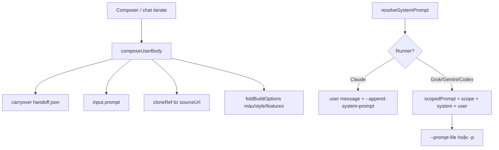

# Desktop runner prompt — cách Toolswave tổng hợp prompt gửi CLI

Tài liệu này mô tả **prompt đầy đủ** mà desktop gửi tới Grok / Gemini / Codex / Claude khi bạn tạo hoặc chỉnh sửa app.

## Xem trực tiếp trong app

1. Mở workspace của app (sau khi tạo hoặc iterate).
2. Ở khung canvas, chọn ô **Prompt** (cạnh Trang / Mã nguồn / CSDL).
3. Gõ yêu cầu ở khung chat bên phải — prompt tổng hợp **cập nhật theo thời gian thực**.
4. Có thể **sửa** system / user / prompt đầy đủ; lần gửi tiếp theo dùng bản đã chỉnh.

File audit trên đĩa (sau mỗi lần build thật):

```
<app-dir>/.toolswave/last-prompt-audit.txt
<app-dir>/.toolswave/grok-prompt.txt   # (hoặc gemini/codex tương ứng)
```

## Luồng tổng hợp



| Thành phần | Nguồn | Ghi chú |
|---|---|---|
| **User body** | `input.prompt` + tùy chọn composer | Trang/tech spec đã gấp sẵn ở Composer |
| **foldBuildOptions** | màu, style, theme, ngôn ngữ, features | Thêm block `Yêu cầu thêm:` |
| **carryover** | `handoff.json` (nếu có) | Chỉ lần build đầu sau handoff |
| **cloneRef** | chụp `sourceUrl` | Chỉ khi sao chép website |
| **System** | `BUILD_SYSTEM_PROMPT` | ~22 quy tắc Vite/React/antd/SQLite/views.json |
| **Scope backstop** | chỉ với non-Claude | Giới hạn ghi file trong `cwd` |

Mã nguồn: `apps/desktop/main/runtime/promptCompose.ts`

## Ví dụ: "tiệm bánh mì" + Grok

Giả sử bạn chọn **Grok**, model **grok-composer-2.5-fast**, mode **build**, màu `#FF6B35`, không URL sao chép, không trang tùy chỉnh.

### 1. User body (phần người dùng)

```
tiệm bánh mì

Yêu cầu thêm:
- Màu chủ đạo: #ff6b35
```

(Nếu từ Composer có thêm trang/công nghệ, chúng nằm **trong** `input.prompt` trước block `Yêu cầu thêm`.)

### 2. System (`BUILD_SYSTEM_PROMPT` — rút gọn)

```
Bạn đang dựng một app web chạy được bằng Vite + React + TypeScript + Tailwind + Ant Design (antd).
…
CÁC TRANG/API (VIEWS) — ghi `.toolswave/views.json` …
CƠ SỞ DỮ LIỆU — better-sqlite3 + server/api.js …
SỬA TỐI THIỂU (khi iterate) …
TỰ KIỂM TRA TRƯỚC KHI KẾT THÚC …
```

(Xem đầy đủ trong `promptCompose.ts` → `BUILD_SYSTEM_PROMPT`.)

### 3. Scope backstop (chỉ Grok/Gemini/Codex)

```
GIỚI HẠN PHẠM VI: chỉ tạo/sửa file BÊN TRONG "/Users/…/apps/app-xxxxx".
TUYỆT ĐỐI KHÔNG ghi/xoá file ngoài thư mục này, KHÔNG chạy lệnh hệ thống ngoài việc tạo/sửa file của app.
```

### 4. Prompt đầy đủ gửi Grok (`grok --prompt-file`)

Ba phần trên được nối bằng `\n\n` (hàm `scopedPrompt`):

```
GIỚI HẠN PHẠM VI: chỉ tạo/sửa file BÊN TRONG "…".

Bạn đang dựng một app web chạy được bằng Vite + React …
(toàn bộ BUILD_SYSTEM_PROMPT)

tiệm bánh mì

Yêu cầu thêm:
- Màu chủ đạo: #ff6b35
```

Lệnh thực tế:

```bash
grok --prompt-file .toolswave/grok-prompt.txt \
     --cwd <app-dir> \
     --always-approve \
     -m grok-composer-2.5-fast
```

### 5. Claude (khác Grok)

- **System** → `--append-system-prompt` (riêng).
- **User** → chỉ phần user body (không có scope backstop trong user message).
- `fullText` trong inspector = user body; system hiển thị tab riêng.

## Override khi gửi (nâng cao)

| Field IPC / `CreateBuildInput` | Tác dụng |
|---|---|
| `userPromptOverride` | Thay toàn bộ user body |
| `systemPromptOverride` | Thay system / append-system-prompt |
| `fullPromptOverride` | Thay cả file prompt (Grok/Gemini/Codex) |

UI **Prompt** pane gửi các override này khi bạn bấm **Gửi** ở chat iterate.

## API preview (không build)

Desktop expose `runtime.composeRunnerPrompt(input)` → `RunnerPromptPreview`:

- `sections.scopeBackstop | system | user`
- `fullText` — bytes chính xác
- `delivery` — `append-system-prompt` hoặc `single-prompt-file`
- `promptFileName` — vd `.toolswave/grok-prompt.txt`